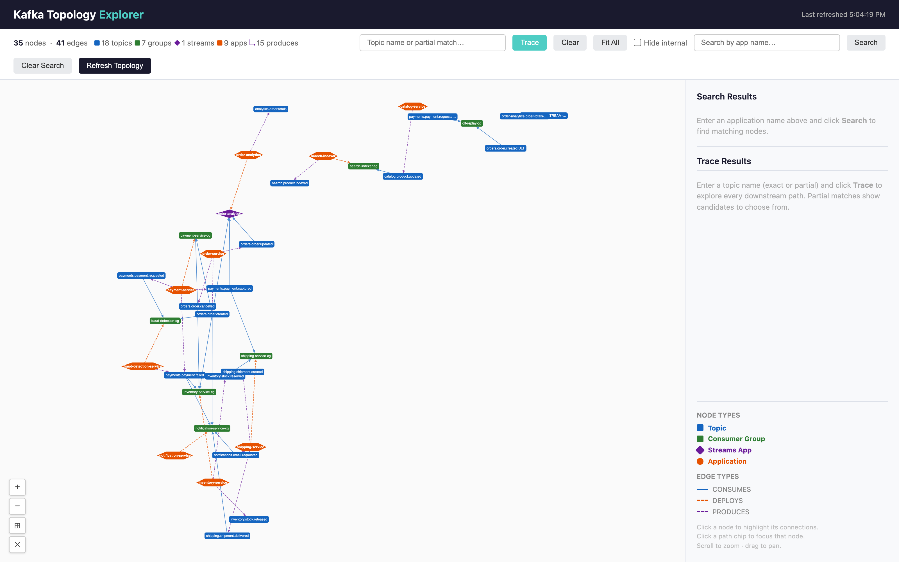
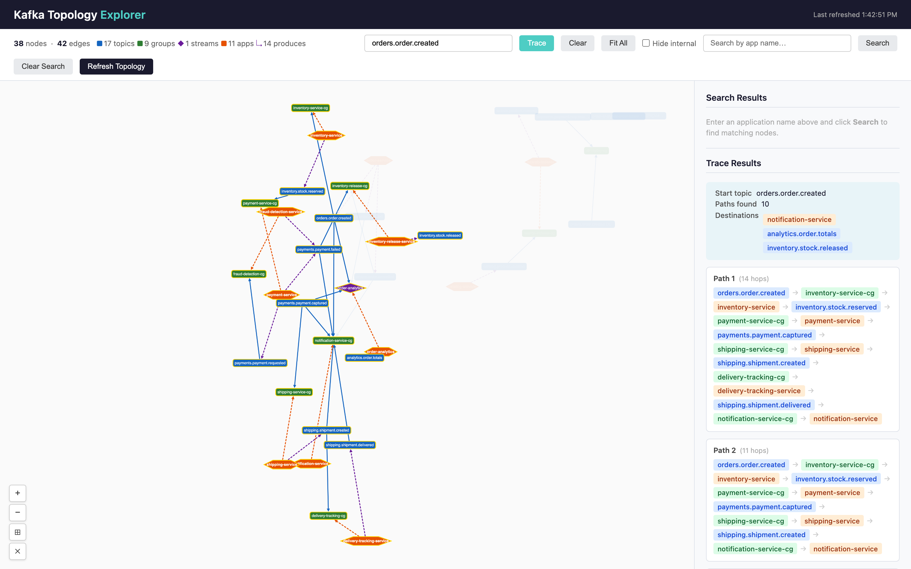

# Kafka Topology Explorer

[](https://github.com/swatibansal/kafka-topology-explorer/actions/workflows/ci.yml)

A Spring Boot service that discovers the full event topology of a Kafka platform and turns it
into an interactive graph: every topic, consumer group, Kafka Streams application, and the
microservices that deploy them. It answers *"who consumes this topic?"* and *"who produces here?"*
without reading a hundred codebases.

This repository is a self-contained demo. `docker compose up` starts a broker, seeds a fictional
e-commerce topology ("Acme Shop"), and launches the explorer against it.



## The problem

Kafka exposes topics and consumer groups through the AdminClient, but:

- there is **no producer registry** — the broker cannot tell you who writes to a topic;
- there is **no application layer** — a consumer group id is just a string, not a service;
- there is **no end-to-end view** — tracing an event from its source topic through every
  downstream consumer means stitching together configuration from many repositories.

The explorer fills those gaps by combining live broker metadata with each service's own Spring
`application.yml`, read either from a local directory or from named repositories in a GitHub
organisation.

## Quick start

Prerequisites: Docker with Compose v2.

```bash
git clone https://github.com/swatibansal/kafka-topology-explorer
cd kafka-topology-explorer
docker compose up
```

Then open <http://localhost:8083/>. The first start builds the image (a few minutes) and pulls
`apache/kafka:3.9.1`. The image build downloads Maven and every dependency inside Docker, so the
first `docker compose up` needs internet access. The broker is ephemeral by design:
`docker compose down` discards the topology and the next `docker compose up` re-seeds it in about
a minute. Re-running the seeder on a broker that is still up re-creates every consumer group from
`demo/groups.txt`, but it never deletes topics, so after editing `demo/topics.txt` start from
`docker compose down`. If port 8083 or 19092 is taken on your machine, set `EXPLORER_PORT` or `KAFKA_HOST_PORT`
in the environment or in a `.env` file next to `docker-compose.yml`.

What you will see:

- the Acme Shop graph: 17 topics (two of them Kafka Streams internal topics), 9 consumer groups,
  1 Kafka Streams app, 11 services;
- **search** — type `payment` to see every node and edge touching payments;
- **hide internal topics** — tick the toolbar box to drop changelog, repartition, retry and
  dead-letter topics from the picture;
- **trace** — pick `orders.order.created` to follow it through every service and the topics
  those services produce in turn: 10 paths, the longest 14 hops deep. The happy path runs
  order → stock reserved → payment captured → shipment created → delivered, with
  notification-service listening at every step; the failure branch runs payment failed
  (declined, or vetoed by fraud review) → notification and → stock released, and stops there;
- **orphans** — the demo seeds two orphans on purpose so the endpoint has something to show.
  `curl localhost:8083/api/topology/orphans` returns `count: 2`: `orders.order.updated.DLT`, a
  dead-letter topic nobody replays (`UNUSED_RETRY_OR_DLT_TOPIC`), and `pricing-service`, a
  decommissioned service whose `application.yml` still names a group and a topic that no longer
  exist (`UNLINKED_APPLICATION`);
- **export** — the same graph as Mermaid, Graphviz DOT, or JSON.



Developer loop (broker in Docker, app from Maven, Java 21+):

```bash
docker compose up -d kafka seed
ENRICHMENT_LOCAL_DIR="$PWD/demo/apps" ./mvnw spring-boot:run
```

The Maven loop needs Java 21 or newer on `PATH`, or `JAVA_HOME` pointing at such a JDK; the
Docker build ships its own.

## How it works

```
Kafka broker (AdminClient)
  ├─ topics + partition metadata + message counts
  └─ consumer groups + committed offsets
          │
          ▼
  TopologyDiscoveryService ──builds──▶ TopologyGraph
          │                              (TOPIC, CONSUMER_GROUP, STREAMS_APP nodes;
          │                               CONSUMES edges)
          ▼
  ApplicationEnrichmentService
          │  reads application.yml per service via an ApplicationSource:
          │    • LocalAppYmlSource   — a directory, one sub-folder per service
          │    • GitHubAppYmlClient  — named repositories in a GitHub organisation
          │  adds APPLICATION nodes + DEPLOYS / PRODUCES edges
          ▼
  TopologyCacheService (background refresh)
          │
          ▼
  REST API + browser UI (port 8083)
```

Architecture notes and the demo design are in [`docs/DESIGN.md`](docs/DESIGN.md).

### Node types

| Type | Represents |
|------|------------|
| `TOPIC` | Kafka topic with partition count, replication factor, message count |
| `CONSUMER_GROUP` | Consumer group that has committed offsets |
| `STREAMS_APP` | Consumer group that also owns `-changelog` / `-repartition` topics |
| `APPLICATION` | Service discovered from its `application.yml` |

### Edge types

| Type | Meaning | Source |
|------|---------|--------|
| `CONSUMES` | Group reads from a topic | broker committed offsets |
| `DEPLOYS` | Application owns a consumer group or Streams app | `application.yml` group id |
| `PRODUCES` | Application writes to a topic | `application.yml` topic names |

## Orphans

A node with no edges is pruned from the graph after each refresh. Pruning removes it from the
picture, never from Kafka: the explorer only reads from the broker and never deletes a topic or a
group. Every pruned node is kept, with the rule that removed it, and served by
`GET /api/topology/orphans` until the next refresh replaces the report.

| Reason | Applies to | Meaning |
|--------|------------|---------|
| `UNCONSUMED_GROUP` | `CONSUMER_GROUP`, `STREAMS_APP` | The broker knows the group, but it has no committed offsets on any topic in the graph (never committed, or only on filtered-out topics) |
| `UNLINKED_APPLICATION` | `APPLICATION` | None of the group ids or topic names in the service's configuration matched a live node; the unmatched candidates stay in the node's metadata |
| `UNUSED_RETRY_OR_DLT_TOPIC` | `TOPIC` | A topic whose name contains `retry` or `dlt` that no group consumes and no known service produces into |

Orphans are candidates for a human to review. A quiet dead-letter topic or a group that has never
committed may be intentional.

## REST API

| Endpoint | Description |
|----------|-------------|
| `GET /api/topology` | Full cached graph as JSON |
| `GET /api/topology/search?q=<text>` | Nodes whose name contains `text`, plus neighbours |
| `GET /api/topology/trace?topic=<name>` | All data-flow paths from a topic: topic → group → owning service → produced topic → … |
| `GET /api/topology/export?format=mermaid\|dot\|json` | Graph export |
| `POST /api/topology/refresh` | Force an immediate re-discovery (returns the refreshed graph; `GET` answers `405`) |
| `GET /api/topology/applications` | Enrichment summary from the last refresh |
| `GET /api/topology/orphans` | Nodes pruned from the last graph build, each with a reason code and description. Read-only; the explorer never deletes anything on the broker |
| `GET /mgmt/health`, `GET /mgmt/prometheus` | Actuator health and metrics |

`/mgmt/health` shows component details (broker connectivity, cache state) and is meant for local
use; restrict or disable it before exposing the service beyond your machine.

## Configuration

Every setting is an environment variable with a local-friendly default.

| Variable | Default | Purpose |
|----------|---------|---------|
| `KAFKA_BOOTSTRAP_SERVERS` | `localhost:19092` | Broker list |
| `KAFKA_SECURITY_PROTOCOL` | `PLAINTEXT` | `PLAINTEXT`, `SSL`, `SASL_PLAINTEXT`, `SASL_SSL` |
| `KAFKA_SASL_MECHANISM` | *(blank)* | e.g. `SCRAM-SHA-512` |
| `KAFKA_SASL_JAAS_CONFIG` | *(blank)* | Full JAAS string, or use the two below |
| `KAFKA_SASL_USERNAME` / `KAFKA_SASL_PASSWORD` | *(blank)* | Credentials from which a JAAS string is built |
| `KAFKA_TOPIC_FILTER` | *(blank = all)* | Comma-separated substrings a topic or consumer-group name must contain |
| `KAFKA_EXCLUDE_NUMERIC_TOPICS` | `true` | Drop topics whose names are purely numeric |
| `KAFKA_TOPOLOGY_REFRESH_MS` | `86400000` | Background refresh interval (default: once a day; use the Refresh button for on-demand) |
| `KAFKA_ADMIN_REQUEST_TIMEOUT_MS` | `30000` | AdminClient per-request timeout (ms) |
| `KAFKA_ADMIN_DEFAULT_API_TIMEOUT_MS` | `30000` | AdminClient overall API timeout (ms) |
| `ENRICHMENT_ACTIVE_PROFILE` | `prod` | Spring profile block to read from each `application.yml` |
| `ENRICHMENT_LOCAL_DIR` | *(blank)* | Directory of `<service>/application.yml`; enables the local source |
| `GITHUB_ENRICHMENT_ENABLED` | `false` | Enables the GitHub source (takes precedence) |
| `GITHUB_ORG`, `GITHUB_TOKEN`, `GITHUB_REPOS` | *(blank)* | Organisation, token with read access to repository contents (classic `repo` scope or fine-grained Contents: read), comma-separated repos |
| `SERVER_PORT` | `8083` | HTTP port |

`ENRICHMENT_ACTIVE_PROFILE` is the profile block read from *each discovered service's*
`application.yml`; it is unrelated to the explorer's own Spring profiles.

## From demo to a deployable unit for your cluster

The demo wires three things together that are specific to every company: the Kafka cluster, the
place service configuration lives, and the way deployments and configuration are managed. The
explorer keeps each behind a seam so you can replace them one at a time.

| Concern | In the demo | In your environment |
|---------|-------------|---------------------|
| Broker | Compose `kafka`, `PLAINTEXT` | Your cluster over `SASL_SSL` with a read-only principal |
| Service configuration | `demo/apps/*/application.yml` | Your code host, service catalog or deployment manifests |
| Scope | Every topic | `KAFKA_TOPIC_FILTER` plus naming conventions |
| Access | Open on `localhost:8083` | Behind your ingress and SSO |
| Deployment | `docker compose up` | The image from the `Dockerfile` in your orchestrator |

### 1. Connect it to your cluster

The explorer only reads. It calls `listTopics`, `describeTopics`, `listOffsets`,
`listConsumerGroups` and `listConsumerGroupOffsets`, so a principal with `Describe` on the
cluster, on all topics and on all groups is enough. Set `KAFKA_BOOTSTRAP_SERVERS`,
`KAFKA_SECURITY_PROTOCOL` and the `KAFKA_SASL_*` variables from your secret manager; never bake
them into the image. Run one explorer per cluster or environment rather than pointing one
instance at several.

Use `KAFKA_TOPIC_FILTER` to scope the graph to the topics that matter: a domain prefix, an
environment prefix, or a team's naming convention. Patterns are substrings applied to topic and
consumer-group names. Kafka Streams detection looks at every topic on the broker, so filtering
out `-changelog` and `-repartition` topics from the graph does not stop a group being classified
as a `STREAMS_APP`.

### 2. Connect it to your code host

`PRODUCES` and `DEPLOYS` edges come from each service's own configuration, so the explorer needs a
way to read it. Two sources ship in the box:

- **Local directory** (`ENRICHMENT_LOCAL_DIR`): one sub-folder per service with its
  `application.yml`. Useful when a CI job or a sidecar checks the configuration out for you.
- **GitHub** (`GITHUB_ENRICHMENT_ENABLED=true`, `GITHUB_ORG`, `GITHUB_REPOS`, `GITHUB_TOKEN`):
  reads `src/main/resources/application.yml` or `application-<profile>.yml` from each named
  repository through the Contents API. Use a fine-grained token or GitHub App installation with
  read access to repository contents only, and list repositories explicitly rather than scanning
  the organisation.

For GitLab, Bitbucket, a monorepo, a service catalog such as Backstage, or Helm values and
Kubernetes ConfigMaps, implement the one-method `ApplicationSource` interface and register it in
`EnrichmentConfig`. If the configuration is still Spring YAML, reuse `AppYmlApplicationParser`.

The extraction rules are heuristics that encode common Spring conventions, and they are the part
most likely to need tuning to your house style. `SpringAppYmlGroupIdExtractor` reads the profile
block named by `ENRICHMENT_ACTIVE_PROFILE` and looks for:

- consumer groups: any key containing `kafka` and `group` (for example
  `spring.kafka.consumer.group-id`) and Kafka Streams `spring.kafka.streams.application-id`;
- produced topics: any key containing `kafka` and `topic`;
- Spring `${VAR:default}` expressions (the default is used) and cross-document references such as
  `"${app.kafka.consumer.group-id-base}-cg"`.

If your group ids or topic names are injected from Helm values or environment variables rather
than defaults in the YAML, point the source at the rendered configuration, or extend the
extractor to read your manifests. `GET /api/topology/applications` lists every candidate that did
not match a live node, which is the quickest way to see what the heuristics missed.

### 3. Deploy it

The `Dockerfile` produces a non-root, layered image with Java 21 included. The service is
stateless: the topology lives in an in-memory cache rebuilt every `KAFKA_TOPOLOGY_REFRESH_MS`
(once a day by default, or on demand via the Refresh button), so a single replica is sufficient and
restarts are cheap. Wire liveness and readiness probes to `/mgmt/health/liveness` and
`/mgmt/health/readiness`, and scrape metrics from `/mgmt/prometheus`. Memory is sized through
`JAVA_TOOL_OPTIONS` (`-XX:MaxRAMPercentage=75.0` is set in the image).

The application has no authentication of its own. Put it behind your ingress and SSO, and do not
expose `/mgmt` or `POST /api/topology/refresh` publicly: the health endpoint shows broker
connectivity details and the refresh endpoint triggers a full re-discovery on every call.

### 4. Manage configuration per environment

Every setting is an environment variable, so a Helm values file or Kustomize overlay per
environment is the natural home for it. The values that usually differ per environment are:

- `KAFKA_BOOTSTRAP_SERVERS` and the security settings;
- `KAFKA_TOPIC_FILTER`, when environments share a cluster and are separated by naming;
- `ENRICHMENT_ACTIVE_PROFILE`, which must name the profile block that *your services* use in that
  environment (the `prod` block of each service's `application.yml` for the production cluster);
- the repository list or configuration directory the enrichment source reads.

Secrets (`KAFKA_SASL_PASSWORD`, `KAFKA_SASL_JAAS_CONFIG`, `GITHUB_TOKEN`) belong in your secret
manager and are injected as environment variables at deploy time.

### 5. Check the graph against reality

`CONSUMES` edges are facts from the broker. `PRODUCES` and `DEPLOYS` edges are inferences from
configuration and inherit any drift between what a service declares and what it does. After the
first deployment, trace a handful of well-understood topics and compare the paths with what the
owning teams expect, then adjust filters and extraction rules until they agree.

## Known limitations

- Producers are invisible at the broker level, so `PRODUCES` edges come from configuration, not
  from live metadata.
- Kafka Streams sink topics cannot be inferred from the broker; only source topics appear as
  `CONSUMES` edges.
- Consumer groups that have never committed offsets have no edges; they are pruned from the graph
  and listed at `GET /api/topology/orphans` with reason `UNCONSUMED_GROUP`.
- A trace is structural. A service that consumes several topics and produces several topics
  links every input to every output, because configuration does not say which input triggers
  which output. Keep that in mind when a path looks like a failure leading to a success. The
  demo sidesteps this by giving every service one business input; in a real estate, services
  that consume unrelated topics will show such cross-links.

## License

Apache License 2.0 — see [LICENSE](LICENSE). Copyright 2026 Collectors Universe, Inc.; see
[NOTICE](NOTICE).

Third-party: the vendored Cytoscape.js (MIT) is listed in
[THIRD_PARTY_NOTICES.md](THIRD_PARTY_NOTICES.md).
